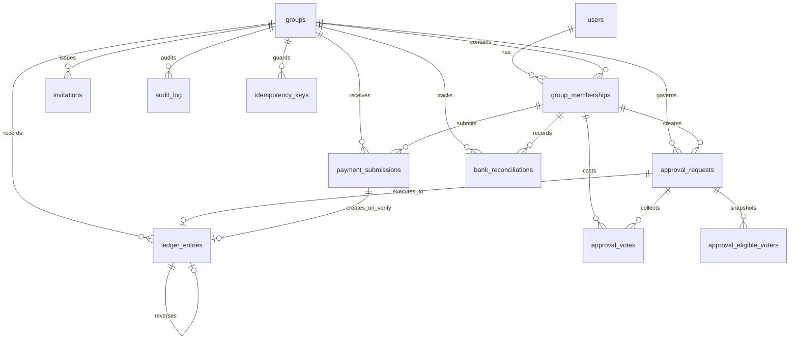

# Database Schema Design

PostgreSQL relational database schema design for Broke Travelers backend API, modeled with Prisma ORM conventions.

---

## 1. Architectural Decisions and Id Strategy
- **Primary Keys**: UUIDv7 (stored as native `UUID`).
  - *Justification*: UUIDv7 embeds a 48-bit UNIX millisecond timestamp followed by random bits. This gives chronological index locality (preventing B-tree index fragmentation), prevents ID enumeration attacks, and avoids coordination bottlenecks compared to autoincrement `BIGINT`.
- **Monetary Storage**: Stored as `BIGINT paisa` (1 NPR = 100 paisa, strictly positive `CHECK (amount_paisa > 0)`). No floating-point or numeric types.
- **Append-Only Guarantees**: `ledger_entries` and `audit_log` tables reject `UPDATE` and `DELETE` operations via PostgreSQL triggers and restricted role privileges (`REVOKE UPDATE, DELETE ON ledger_entries, audit_log FROM api_user`).
- **Verified Balance Derivation**: Computed dynamically via indexed SQL aggregate query over `ledger_entries` (`SUM(signed_paisa)`). At target volume (~6 members, hundreds of rows/year), an indexed sum runs in `< 1ms`. No maintained cached balance column is stored, eliminating balance drift and write-skew anomalies.
- **Posting Concurrency Control**: All financial writes acquire an exclusive row lock on the parent group record (`SELECT id FROM groups WHERE id = $1 FOR UPDATE`) within a database transaction. This serializes postings per group and guarantees two concurrent transactions cannot overdraw the verified balance.

---

## 2. FIN-1 Resolution: Submissions vs Ledger
In the Flutter mock, pending payments were stored directly inside the ledger list and mutated in-place.
The PostgreSQL schema strictly decouples lifecycle submissions from posted ledger entries:
- `payment_submissions`: State machine (`pending`, `verified`, `rejected`) for member payment claims.
- `ledger_entries`: Strictly verified, immutable financial events.
- **Verification Flow**: In a single transaction:
  1. Acquire lock: `SELECT id FROM groups WHERE id = $1 FOR UPDATE;`
  2. Verify submission status is `pending`.
  3. Update `payment_submissions` (`status = 'verified'`, `reviewed_by_member_id`, `reviewed_at`).
  4. Insert immutable row into `ledger_entries` (`kind = 'contribution'`).
  5. Set `payment_submissions.posted_ledger_entry_id = ledger_entry.id`.
  6. Append audit log entry.

---

## 3. Entity Definitions

### 3.1 `users`
Represents an authenticated user linked to Firebase Authentication.
| Column | Type | Nullable | Constraints & Description |
|---|---|---|---|
| `id` | `UUID` | No | PK, default UUIDv7 |
| `firebase_uid` | `VARCHAR(128)` | No | UNIQUE, indexed (Firebase UID from JWT) |
| `email` | `VARCHAR(255)` | No | Normalized lowercase email |
| `display_name` | `VARCHAR(100)` | No | User's full name |
| `created_at` | `TIMESTAMPTZ` | No | Default `NOW()` |
| `updated_at` | `TIMESTAMPTZ` | No | Default `NOW()` |

### 3.2 `groups`
Top-level tenant boundary for a savings circle.
| Column | Type | Nullable | Constraints & Description |
|---|---|---|---|
| `id` | `UUID` | No | PK, default UUIDv7 |
| `name` | `VARCHAR(60)` | No | Group name (2 to 60 characters) |
| `expected_paisa` | `BIGINT` | No | Monthly contribution in paisa, `CHECK (expected_paisa > 0)` |
| `due_day` | `SMALLINT` | No | Day of month (1 to 28), `CHECK (due_day BETWEEN 1 AND 28)` |
| `created_by_user_id` | `UUID` | No | FK -> `users.id` |
| `created_at` | `TIMESTAMPTZ` | No | Default `NOW()` |
| `updated_at` | `TIMESTAMPTZ` | No | Default `NOW()` |

### 3.3 `group_memberships`
Roster membership linking users to groups, tracking roles and soft deletion.
| Column | Type | Nullable | Constraints & Description |
|---|---|---|---|
| `id` | `UUID` | No | PK, default UUIDv7 |
| `group_id` | `UUID` | No | FK -> `groups.id` ON DELETE CASCADE |
| `user_id` | `UUID` | No | FK -> `users.id` |
| `is_owner` | `BOOLEAN` | No | Default `FALSE` |
| `is_treasurer` | `BOOLEAN` | No | Default `FALSE` |
| `joined_at` | `TIMESTAMPTZ` | No | Default `NOW()` |
| `left_at` | `TIMESTAMPTZ` | Yes | Soft removal timestamp (`NULL` = active) |
| `created_at` | `TIMESTAMPTZ` | No | Default `NOW()` |
- **Indexes & Constraints**:
  - `UNIQUE (group_id, user_id)` (A user has at most one active/historical roster record per group).
  - Index on `(group_id, left_at)` for active roster queries.

### 3.4 `invitations`
Single-use invitation codes created by group owners.
| Column | Type | Nullable | Constraints & Description |
|---|---|---|---|
| `id` | `UUID` | No | PK, default UUIDv7 |
| `group_id` | `UUID` | No | FK -> `groups.id` ON DELETE CASCADE |
| `code` | `VARCHAR(8)` | No | UNIQUE, uppercase alphanumeric excluding ambiguous chars |
| `status` | `VARCHAR(20)` | No | Enum: `'pending'`, `'accepted'`, `'revoked'`, `'expired'` |
| `created_by_member_id` | `UUID` | No | FK -> `group_memberships.id` |
| `accepted_by_user_id` | `UUID` | Yes | FK -> `users.id` |
| `created_at` | `TIMESTAMPTZ` | No | Default `NOW()` |
| `expires_at` | `TIMESTAMPTZ` | No | Default `NOW() + INTERVAL '7 days'` |
- **Indexes**: `CREATE INDEX idx_invitations_code ON invitations(code) WHERE status = 'pending';`

### 3.5 `payment_submissions`
Member payment submission lifecycle records.
| Column | Type | Nullable | Constraints & Description |
|---|---|---|---|
| `id` | `UUID` | No | PK, default UUIDv7 |
| `group_id` | `UUID` | No | FK -> `groups.id` ON DELETE CASCADE |
| `member_id` | `UUID` | No | FK -> `group_memberships.id` |
| `period_month` | `DATE` | No | First day of obligation month (`YYYY-MM-01`) |
| `amount_paisa` | `BIGINT` | No | Server-set expected amount, `CHECK (amount_paisa > 0)` |
| `payment_method` | `VARCHAR(20)` | No | Enum: `'esewa'`, `'khalti'`, `'bankTransfer'`, `'cash'` |
| `reference` | `VARCHAR(100)` | Yes | Normalized reference string |
| `note` | `VARCHAR(200)` | Yes | Optional submitter note |
| `status` | `VARCHAR(30)` | No | Enum: `'pending'`, `'verified'`, `'rejected'` |
| `submitted_at` | `TIMESTAMPTZ` | No | Default `NOW()` |
| `reviewed_by_member_id`| `UUID` | Yes | FK -> `group_memberships.id` |
| `reviewed_at` | `TIMESTAMPTZ` | Yes | Timestamp of verification/rejection |
| `rejection_reason` | `VARCHAR(30)` | Yes | Enum: `'notReceived'`, `'wrongAmount'`, `'referenceNotFound'`, `'other'` |
| `rejection_note` | `VARCHAR(200)` | Yes | Reviewer feedback note |
| `posted_ledger_entry_id`| `UUID` | Yes | FK -> `ledger_entries.id` (set on verification) |
- **Indexes & Constraints**:
  - `UNIQUE (group_id, payment_method, reference)` WHERE `status IN ('pending', 'verified') AND reference IS NOT NULL`.
  - Index on `(group_id, member_id, period_month, submitted_at DESC)`.

### 3.6 `ledger_entries` (APPEND-ONLY)
Immutable financial record of verified contributions, interest, expenses, and withdrawals.
| Column | Type | Nullable | Constraints & Description |
|---|---|---|---|
| `id` | `UUID` | No | PK, default UUIDv7 |
| `group_id` | `UUID` | No | FK -> `groups.id` ON DELETE CASCADE |
| `kind` | `VARCHAR(20)` | No | Enum: `'contribution'`, `'interest'`, `'expense'`, `'withdrawal'` |
| `title` | `VARCHAR(60)` | No | Title description (2 to 60 characters) |
| `magnitude_paisa` | `BIGINT` | No | Absolute amount, `CHECK (magnitude_paisa > 0)` |
| `occurred_at` | `TIMESTAMPTZ` | No | Activity occurrence timestamp |
| `posted_at` | `TIMESTAMPTZ` | No | Server database timestamp, default `NOW()` |
| `member_id` | `UUID` | Yes | FK -> `group_memberships.id` (contributions only) |
| `period_month` | `DATE` | Yes | Obligation month (contributions only) |
| `payment_method` | `VARCHAR(20)` | Yes | Payment channel if applicable |
| `note` | `VARCHAR(200)` | Yes | Optional memo |
| `reverses_entry_id` | `UUID` | Yes | FK -> `ledger_entries.id` (reversal entries only) |
| `actor_member_id` | `UUID` | No | FK -> `group_memberships.id` (who posted) |
- **Indexes & Constraints**:
  - `CHECK (reverses_entry_id IS NULL OR kind IN ('expense', 'interest'))`.
  - `UNIQUE (reverses_entry_id)` (An entry cannot be reversed more than once).
  - Index on `(group_id, occurred_at DESC)`.
  - Index on `(group_id, period_month)`.

### 3.7 `approval_requests`
Multi-member governance for shared fund withdrawals and expenses.
| Column | Type | Nullable | Constraints & Description |
|---|---|---|---|
| `id` | `UUID` | No | PK, default UUIDv7 |
| `group_id` | `UUID` | No | FK -> `groups.id` ON DELETE CASCADE |
| `kind` | `VARCHAR(20)` | No | Enum: `'expense'`, `'withdrawal'` |
| `requester_member_id` | `UUID` | No | FK -> `group_memberships.id` |
| `title` | `VARCHAR(60)` | No | Request title |
| `payee` | `VARCHAR(60)` | No | Target payee |
| `description` | `VARCHAR(200)` | Yes | Purpose / context |
| `amount_paisa` | `BIGINT` | No | Amount, `CHECK (amount_paisa > 0)` |
| `status` | `VARCHAR(20)` | No | Enum: `'open'`, `'approved'`, `'rejected'`, `'cancelled'`, `'executed'` |
| `created_at` | `TIMESTAMPTZ` | No | Default `NOW()` |
| `expires_at` | `TIMESTAMPTZ` | No | Default `NOW() + INTERVAL '7 days'` |
| `closed_at` | `TIMESTAMPTZ` | Yes | Decision / execution timestamp |
| `executed_entry_id` | `UUID` | Yes | FK -> `ledger_entries.id` (set on execution) |
| `executed_by_member_id`| `UUID` | Yes | FK -> `group_memberships.id` |

### 3.8 `approval_eligible_voters` & `approval_votes`
Snapshotted voter roster and recorded votes.
- `approval_eligible_voters`: `(request_id UUID, member_id UUID, PRIMARY KEY (request_id, member_id))`.
- `approval_votes`: `(request_id UUID, member_id UUID, approve BOOLEAN, voted_at TIMESTAMPTZ, PRIMARY KEY (request_id, member_id))`.

### 3.9 `bank_reconciliations`
Informational statement balance comparisons.
| Column | Type | Nullable | Constraints & Description |
|---|---|---|---|
| `id` | `UUID` | No | PK, default UUIDv7 |
| `group_id` | `UUID` | No | FK -> `groups.id` ON DELETE CASCADE |
| `statement_date` | `DATE` | No | External statement calendar date |
| `bank_balance_paisa` | `BIGINT` | No | External balance, `CHECK (bank_balance_paisa >= 0)` |
| `recorded_balance_paisa`| `BIGINT` | No | Verified ledger balance as of statement date |
| `difference_paisa` | `BIGINT` | No | `bank_balance_paisa - recorded_balance_paisa` |
| `note` | `VARCHAR(200)` | Yes | Optional notes |
| `recorded_by_member_id` | `UUID` | No | FK -> `group_memberships.id` |
| `recorded_at` | `TIMESTAMPTZ` | No | Default `NOW()` |
- **Constraints**: `UNIQUE (group_id, statement_date)`.

### 3.10 `audit_log` (APPEND-ONLY)
Append-only log of configuration changes and financial operations.
| Column | Type | Nullable | Constraints & Description |
|---|---|---|---|
| `id` | `UUID` | No | PK, default UUIDv7 |
| `group_id` | `UUID` | No | FK -> `groups.id` |
| `actor_user_id` | `UUID` | No | FK -> `users.id` |
| `action` | `VARCHAR(50)` | No | Operation identifier (e.g. `payment.verified`) |
| `field` | `VARCHAR(100)` | No | Target entity or field |
| `before_value` | `TEXT` | No | State before |
| `after_value` | `TEXT` | No | State after |
| `created_at` | `TIMESTAMPTZ` | No | Server timestamp `NOW()` |

### 3.11 `idempotency_keys`
Deduplication cache for financial POST requests.
| Column | Type | Nullable | Constraints & Description |
|---|---|---|---|
| `id` | `UUID` | No | PK, default UUIDv7 |
| `group_id` | `UUID` | No | Group scope |
| `actor_user_id` | `UUID` | No | User scope |
| `operation` | `VARCHAR(50)` | No | e.g. `submit_payment`, `record_transaction` |
| `idempotency_key` | `VARCHAR(100)` | No | Client token |
| `request_hash` | `CHAR(64)` | No | SHA-256 fingerprint of request body |
| `response_status` | `INTEGER` | No | Cached HTTP response status |
| `response_body` | `JSONB` | No | Cached JSON response |
| `created_at` | `TIMESTAMPTZ` | No | Default `NOW()` |
| `expires_at` | `TIMESTAMPTZ` | No | `NOW() + INTERVAL '48 hours'` |
- **Constraints**: `UNIQUE (group_id, actor_user_id, operation, idempotency_key)`.

### 3.12 `user_update_reads` (Updates Read-State)
Stores individual item read timestamps per user to support persistent unread badges across devices without storing static feeds.
| Column | Type | Nullable | Constraints & Description |
|---|---|---|---|
| `user_id` | `UUID` | No | FK -> `users.id` |
| `group_id` | `UUID` | No | FK -> `groups.id` |
| `feed_item_id` | `VARCHAR(100)` | No | Stable synthesized ID (e.g. `due-2026-11`) |
| `read_at` | `TIMESTAMPTZ` | No | Timestamp item was marked read |
- **Constraints**: `PRIMARY KEY (user_id, group_id, feed_item_id)`.

---

## 4. Entity Relationship Diagram

---

## 5. Backup and Restore Strategy
1. **Automated Logical Backups**:
   - Daily automated `pg_dump -Fc --no-owner --no-privileges` backup executed via cron or worker job.
   - Pushed via S3 API to owner-controlled encrypted cold storage (e.g. Cloudflare R2 / AWS S3).
   - Retain 7 daily snapshots and 4 weekly snapshots.
2. **Restore Test Drill**:
   - Monthly scripted restore drill restoring into a local Docker PostgreSQL container:
     `pg_restore --clean --if-exists -d broke_travelers_test < backup.dump`
   - Run verification assertions on ledger balance sum and entry count.
3. **Free Database Tier Risk Mitigation**:
   - Free tiers (e.g., Neon free tier) may archive inactive databases or have short point-in-time recovery windows. Independent daily dumps ensure complete operational independence and rapid migration to any PostgreSQL host.

---

## 6. Open Decisions for the Owner
1. **Multi-Group vs Single-Group UI Constraint**: The DB schema supports multi-group membership per user. The Flutter mock currently assumes one active group per user (`membershipByUserId`). Confirm whether users should be allowed to switch active groups in the app.
2. **Re-Invitation Data Merging**: When a previously removed member rejoins with a new invitation code, should the app keep their historical records under the old member ID, or alias them under the new membership?
3. **Idempotency Retention Window**: 48 hours is proposed. Confirm if this window is sufficient for intermittent offline travel scenarios.
