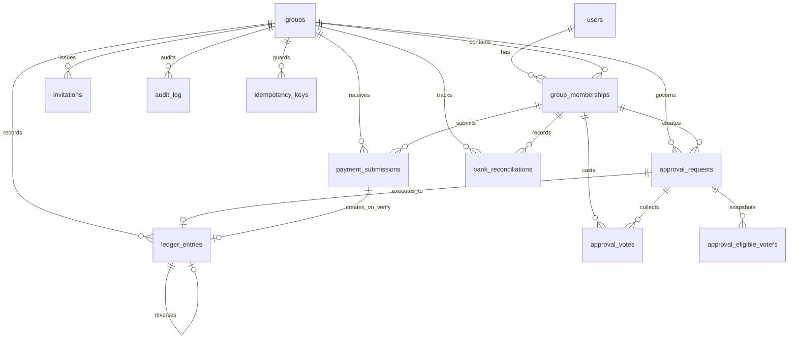

# Database Schema Design

PostgreSQL relational database schema design for Broke Travelers backend API, modeled with Prisma ORM conventions.

---

## 1. Architectural Decisions and Id Strategy
- **Primary Keys**: UUIDv7 (stored as native `UUID`). Embeds a 48-bit UNIX millisecond timestamp followed by random bits, ensuring chronological index locality, preventing enumeration, and avoiding autoincrement bottlenecks.
- **Monetary Storage**: Stored as `BIGINT paisa` (1 NPR = 100 paisa, strictly positive `CHECK (amount_paisa > 0)`). No floating-point or numeric types.
- **Append-Only Guarantees**: `ledger_entries` and `audit_log` tables reject `UPDATE` and `DELETE` operations via PostgreSQL triggers and runtime role privilege restrictions (`REVOKE UPDATE, DELETE ON ledger_entries, audit_log FROM api_user`).
- **Posting Concurrency Control**: All financial writes acquire an exclusive row lock on the parent group record (`SELECT id FROM groups WHERE id = $1 FOR UPDATE`) within a database transaction. This serializes postings per group and guarantees two concurrent transactions cannot overdraw the verified balance.
- **Deletion Policy (Phase 5)**: Groups and users are NEVER hard-deleted. All foreign keys referencing `groups` or `users` on immutable or auditable tables (`ledger_entries`, `payment_submissions`, `approval_requests`, `bank_reconciliations`, `audit_log`, `idempotency_keys`) use `ON DELETE RESTRICT`.

---

## 2. FIN-1 Resolution: Submissions vs Ledger
In the Flutter mock, pending payments were stored directly inside the ledger list and mutated in-place.
The PostgreSQL schema strictly decouples lifecycle submissions from posted ledger entries:
- `payment_submissions`: State machine (`pending`, `verified`, `rejected`) for member payment claims.
- `ledger_entries`: Strictly verified, immutable financial events.
- **Verification Flow**: In a single transaction:
  1. Acquire group lock: `SELECT id FROM groups WHERE id = $1 FOR UPDATE;`
  2. Verify submission status is `pending`.
  3. Update `payment_submissions` (`status = 'verified'`, `reviewed_by_member_id`, `reviewed_at = NOW()`).
  4. Insert immutable row into `ledger_entries` (`kind = 'contribution'`).
  5. Set `payment_submissions.posted_ledger_entry_id = ledger_entry.id`.
  6. Append audit log entry.

---

## 3. Entity Definitions

### 3.1 `users`
Authenticated user linked to Firebase Authentication.
| Column | Type | Nullable | Constraints & Description |
|---|---|---|---|
| `id` | `UUID` | No | PK, default UUIDv7 |
| `firebase_uid` | `VARCHAR(128)` | No | UNIQUE, indexed (Firebase UID from JWT) |
| `email` | `VARCHAR(255)` | No | Normalized lowercase email |
| `display_name` | `VARCHAR(100)` | No | User full name |
| `created_at` | `TIMESTAMPTZ` | No | Default `NOW()` |
| `updated_at` | `TIMESTAMPTZ` | No | Default `NOW()` |

### 3.2 `groups`
Top-level tenant boundary for a savings circle.
| Column | Type | Nullable | Constraints & Description |
|---|---|---|---|
| `id` | `UUID` | No | PK, default UUIDv7 |
| `name` | `VARCHAR(60)` | No | Group name (2 to 60 characters) |
| `expected_paisa` | `BIGINT` | No | Monthly contribution in paisa, `CHECK (expected_paisa > 0)` |
| `due_day` | `SMALLINT` | No | Day of month (1 to 28), `CHECK (due_day BETWEEN 1 AND 28)` |
| `created_by_user_id` | `UUID` | No | FK -> `users.id` ON DELETE RESTRICT |
| `created_at` | `TIMESTAMPTZ` | No | Default `NOW()` |
| `updated_at` | `TIMESTAMPTZ` | No | Default `NOW()` |

### 3.3 `group_memberships`
Roster membership linking users to groups, tracking roles and soft deletion.
| Column | Type | Nullable | Constraints & Description |
|---|---|---|---|
| `id` | `UUID` | No | PK, default UUIDv7 |
| `group_id` | `UUID` | No | FK -> `groups.id` ON DELETE RESTRICT |
| `user_id` | `UUID` | No | FK -> `users.id` ON DELETE RESTRICT |
| `is_owner` | `BOOLEAN` | No | Default `FALSE` |
| `is_treasurer` | `BOOLEAN` | No | Default `FALSE` |
| `joined_at` | `TIMESTAMPTZ` | No | Default `NOW()` |
| `left_at` | `TIMESTAMPTZ` | Yes | Soft removal timestamp (`NULL` = active) |
| `created_at` | `TIMESTAMPTZ` | No | Default `NOW()` |
- **Rejoining & Historical Integrity**: If a member leaves and is re-invited, accepting the invitation creates a NEW membership row with `joined_at = NOW()` and `left_at = NULL`. Historical ledger entries and submissions stay linked to the previous membership row.
- **Constraints & Indexes**:
  - Partial unique index: `CREATE UNIQUE INDEX idx_group_memberships_active_user ON group_memberships (group_id, user_id) WHERE left_at IS NULL;` (ensures at most one active membership per user per group). Note: Prisma schema cannot declare partial indexes; this index is created in raw SQL migrations.
  - Index on `(group_id, left_at)` for active roster queries.

### 3.4 `invitations`
Single-use invitation codes created by group owners.
| Column | Type | Nullable | Constraints & Description |
|---|---|---|---|
| `id` | `UUID` | No | PK, default UUIDv7 |
| `group_id` | `UUID` | No | FK -> `groups.id` ON DELETE RESTRICT |
| `code` | `VARCHAR(8)` | No | UNIQUE, uppercase alphanumeric excluding ambiguous chars |
| `status` | `VARCHAR(20)` | No | Enum: `'pending'`, `'accepted'`, `'revoked'`, `'expired'` |
| `created_by_member_id` | `UUID` | No | FK -> `group_memberships.id` ON DELETE RESTRICT |
| `accepted_by_user_id` | `UUID` | Yes | FK -> `users.id` ON DELETE RESTRICT |
| `created_at` | `TIMESTAMPTZ` | No | Default `NOW()` |
| `expires_at` | `TIMESTAMPTZ` | No | Default `NOW() + INTERVAL '7 days'` |

### 3.5 `payment_submissions`
Member payment submission lifecycle records.
| Column | Type | Nullable | Constraints & Description |
|---|---|---|---|
| `id` | `UUID` | No | PK, default UUIDv7 |
| `group_id` | `UUID` | No | FK -> `groups.id` ON DELETE RESTRICT |
| `member_id` | `UUID` | No | FK -> `group_memberships.id` ON DELETE RESTRICT |
| `period_month` | `DATE` | No | First day of obligation month (`YYYY-MM-01`) |
| `amount_paisa` | `BIGINT` | No | Server-set expected amount, `CHECK (amount_paisa > 0)` |
| `payment_method` | `VARCHAR(20)` | No | Enum: `'esewa'`, `'khalti'`, `'bankTransfer'`, `'cash'` |
| `reference` | `VARCHAR(100)` | Yes | Normalized reference string |
| `note` | `VARCHAR(200)` | Yes | Optional submitter note |
| `status` | `VARCHAR(30)` | No | Enum: `'pending'`, `'verified'`, `'rejected'` |
| `submitted_at` | `TIMESTAMPTZ` | No | Default `NOW()` |
| `reviewed_by_member_id`| `UUID` | Yes | FK -> `group_memberships.id` ON DELETE RESTRICT |
| `reviewed_at` | `TIMESTAMPTZ` | Yes | Timestamp of verification/rejection |
| `rejection_reason` | `VARCHAR(30)` | Yes | Enum: `'notReceived'`, `'wrongAmount'`, `'referenceNotFound'`, `'other'` |
| `rejection_note` | `VARCHAR(200)` | Yes | Reviewer feedback note |
| `posted_ledger_entry_id`| `UUID` | Yes | FK -> `ledger_entries.id` ON DELETE RESTRICT |
- **Obligation Derivation Ordering**: To determine the latest submission for a period obligation, queries sort by `submitted_at DESC`, breaking ties with `id DESC`.
- **Constraints & Indexes**:
  - `UNIQUE (group_id, payment_method, reference)` WHERE `status IN ('pending', 'verified') AND reference IS NOT NULL`.
  - Index on `(group_id, member_id, period_month, submitted_at DESC)`.

### 3.6 `ledger_entries` (APPEND-ONLY)
Immutable financial record of verified contributions, interest, expenses, and withdrawals.
| Column | Type | Nullable | Constraints & Description |
|---|---|---|---|
| `id` | `UUID` | No | PK, default UUIDv7 |
| `group_id` | `UUID` | No | FK -> `groups.id` ON DELETE RESTRICT |
| `kind` | `VARCHAR(20)` | No | Enum: `'contribution'`, `'interest'`, `'expense'`, `'withdrawal'` |
| `title` | `VARCHAR(60)` | No | Title description (2 to 60 characters) |
| `magnitude_paisa` | `BIGINT` | No | Absolute amount, `CHECK (magnitude_paisa > 0)` |
| `occurred_at` | `TIMESTAMPTZ` | No | Activity occurrence timestamp |
| `posted_at` | `TIMESTAMPTZ` | No | Server database timestamp, default `NOW()` |
| `member_id` | `UUID` | Yes | FK -> `group_memberships.id` ON DELETE RESTRICT (contributions only) |
| `period_month` | `DATE` | Yes | Obligation month (contributions only) |
| `payment_method` | `VARCHAR(20)` | Yes | Payment channel if applicable |
| `note` | `VARCHAR(200)` | Yes | Optional memo |
| `reverses_entry_id` | `UUID` | Yes | FK -> `ledger_entries.id` ON DELETE RESTRICT (reversal entries only) |
| `actor_member_id` | `UUID` | No | FK -> `group_memberships.id` ON DELETE RESTRICT (who posted) |
- **Constraints & Indexes**:
  - `CHECK (reverses_entry_id IS NULL OR kind IN ('expense', 'interest'))`.
  - `UNIQUE (reverses_entry_id)` (An entry cannot be reversed more than once).
  - Index on `(group_id, occurred_at DESC)`.

### 3.7 `approval_requests`, `approval_eligible_voters` & `approval_votes`
Multi-member governance for shared fund withdrawals and expenses.
- `approval_requests`: `id` (PK UUID), `group_id` (FK RESTRICT), `kind` (`'expense'`, `'withdrawal'`), `requester_member_id` (FK RESTRICT), `title`, `payee`, `description`, `amount_paisa`, `status` (`'open'`, `'approved'`, `'rejected'`, `'cancelled'`, `'executed'`), `created_at`, `expires_at`, `closed_at`, `executed_entry_id` (FK RESTRICT), `executed_by_member_id` (FK RESTRICT).
- `approval_eligible_voters`: `(request_id UUID FK RESTRICT, member_id UUID FK RESTRICT, PRIMARY KEY (request_id, member_id))`.
- `approval_votes`: `(request_id UUID FK RESTRICT, member_id UUID FK RESTRICT, approve BOOLEAN, voted_at TIMESTAMPTZ, PRIMARY KEY (request_id, member_id))`.

### 3.8 `bank_reconciliations`
Informational statement balance comparisons.
- Columns: `id` (PK UUID), `group_id` (FK RESTRICT), `statement_date` (DATE), `bank_balance_paisa` (BIGINT), `recorded_balance_paisa` (BIGINT), `difference_paisa` (BIGINT), `note`, `recorded_by_member_id` (FK RESTRICT), `recorded_at` (TIMESTAMPTZ).
- Constraints: `UNIQUE (group_id, statement_date)`.

### 3.9 `audit_log` (APPEND-ONLY)
Append-only log of configuration changes and financial operations.
- Columns: `id` (PK UUID), `group_id` (FK RESTRICT), `actor_user_id` (FK RESTRICT), `action` (VARCHAR), `field` (VARCHAR), `before_value` (TEXT), `after_value` (TEXT), `created_at` (TIMESTAMPTZ default `NOW()`).

### 3.10 `idempotency_keys`
Deduplication cache for financial and group creation/join POST requests.
| Column | Type | Nullable | Constraints & Description |
|---|---|---|---|
| `id` | `UUID` | No | PK, default UUIDv7 |
| `group_id` | `UUID` | Yes | Nullable to allow user-scoped keys (group creation, accept invitation) |
| `actor_user_id` | `UUID` | No | User scope, FK -> `users.id` ON DELETE RESTRICT |
| `operation` | `VARCHAR(50)` | No | e.g. `submit_payment`, `record_transaction`, `create_group` |
| `idempotency_key` | `VARCHAR(100)` | No | Client token |
| `request_hash` | `CHAR(64)` | No | SHA-256 fingerprint of request body |
| `response_status` | `INTEGER` | No | Cached HTTP response status |
| `response_body` | `JSONB` | No | Cached JSON response |
| `created_at` | `TIMESTAMPTZ` | No | Default `NOW()` |
| `expires_at` | `TIMESTAMPTZ` | No | `NOW() + INTERVAL '48 hours'` |
- **Scope & Constraints**:
  - Two partial unique indexes:
    1. `CREATE UNIQUE INDEX idx_idempotency_group_scoped ON idempotency_keys (group_id, actor_user_id, operation, idempotency_key) WHERE group_id IS NOT NULL;`
    2. `CREATE UNIQUE INDEX idx_idempotency_user_scoped ON idempotency_keys (actor_user_id, operation, idempotency_key) WHERE group_id IS NULL;`
- **Transaction & Locking Semantics**: The idempotency record is inserted in the SAME database transaction as the financial write, AFTER the group row lock (`FOR UPDATE`) is acquired. If the transaction aborts, no key record persists. If two concurrent requests supply the same key, the unique index serializes them: the winner executes and writes the response; the loser fails with unique constraint violation, waits, and reads the stored response.
- **Natural Uniqueness as Second Line of Defense**: If a client retries after the 48-hour key window, natural schema constraints prevent duplicate financial mutations: method-scoped reference uniqueness on submissions, `reverses_entry_id` uniqueness on reversals, `(group_id, statement_date)` uniqueness on reconciliations, and `executed_entry_id` on approvals.

### 3.11 `user_update_reads`
Read timestamps per user to support persistent unread badges across devices.
- `(user_id UUID FK RESTRICT, group_id UUID FK RESTRICT, feed_item_id VARCHAR(100), read_at TIMESTAMPTZ, PRIMARY KEY (user_id, group_id, feed_item_id))`.

---

## 4. Unified Activity Read Model
Activity feed and transaction detail must display both verified ledger entries AND unreviewed/rejected submissions without duplicate items:
- **Architecture Recommendation**: Service-level union or SQL View (`v_activity_items`). A SQL `UNION ALL` view is recommended for consistent pagination:
  ```sql
  CREATE VIEW v_activity_items AS
  SELECT
    'ledger:' || le.id::text AS id,
    'ledger' AS source,
    le.id AS raw_id,
    le.group_id,
    le.kind,
    le.title,
    le.magnitude_paisa AS amount_paisa,
    'verified' AS status,
    le.occurred_at,
    le.member_id,
    le.payment_method,
    le.note,
    le.reverses_entry_id
  FROM ledger_entries le
  UNION ALL
  SELECT
    'submission:' || ps.id::text AS id,
    'submission' AS source,
    ps.id AS raw_id,
    ps.group_id,
    'contribution' AS kind,
    gm.display_name || '''s contribution' AS title,
    ps.amount_paisa,
    ps.status,
    ps.submitted_at AS occurred_at,
    ps.member_id,
    ps.payment_method,
    ps.note,
    NULL::uuid AS reverses_entry_id
  FROM payment_submissions ps
  JOIN group_memberships gm ON gm.id = ps.member_id
  WHERE ps.posted_ledger_entry_id IS NULL; -- Omits verified submissions already in ledger
  ```
- **Duplicate Prevention**: When a submission is verified, `posted_ledger_entry_id` is set. The submission is filtered out from `v_activity_items`; only the resulting verified ledger entry appears. The user sees a seamless transition from pending to verified without duplicate rows.
- **Keyset Cursor**: Sorted by `occurred_at DESC, id DESC`. Cursor encodes `(occurred_at, id)`.

---

## 5. Single Implementation of Balance and Obligation Status
- **TypeScript Domain as Sole Authority**: Business logic is NOT duplicated in SQL stored procedures. The TypeScript domain functions (`signedPaisa`, `verifiedBalancePaisa`, `deriveObligationStatus`), ported 1:1 from Dart, are the ONLY source of truth.
- **Posting Balance Guard**: When recording a transaction, verifying a payment, or executing an approval:
  1. Transaction acquires row lock: `SELECT id FROM groups WHERE id = $1 FOR UPDATE`.
  2. Loads all group `ledger_entries` (for balance) and active `payment_submissions` (for obligations).
  3. Executes the pure TypeScript domain function to calculate current verified balance.
  4. Asserts `current_balance + effect >= 0`. If negative, aborts with `insufficient_balance` (409).
  5. Inserts new entry and commits.
- **Data Size Context**: For groups of ~6 members (~100-300 rows/year), fetching ledger rows takes `< 2ms`. Running the pure domain calculation in-memory eliminates SQL/domain divergence. SQL `SUM` queries are reserved for monitoring checks and validated by parity unit tests.

---

## 6. Database Roles and Migrations
- **Database Roles**:
  - `migration_owner`: Full DDL privileges, owns tables, executes Prisma migrations, creates raw triggers and partial indexes.
  - `api_user`: Runtime role used by Express. Has `SELECT`, `INSERT` on all tables; `UPDATE` on `groups`, `group_memberships`, `payment_submissions`, `approval_requests`, `invitations`; strictly `REVOKE UPDATE, DELETE ON ledger_entries, audit_log`.
- **Neon Specifics**:
  - `DATABASE_URL`: Pooled connection string (`port 6543`, `?pgbouncer=true`) for application runtime, avoiding connection exhaustion.
  - `DIRECT_URL`: Direct connection string (`port 5432`) configured as `directUrl` in `schema.prisma` for running DDL migrations and raw SQL triggers.

---

## 7. Entity Relationship Diagram



---

## 8. Backup and Restore Strategy
1. **Automated Logical Backups via GitHub Actions**:
   - Render free instances do not support standing cron jobs. Instead, a scheduled GitHub Actions workflow in this repository runs daily `pg_dump -Fc --no-owner --no-privileges` using the database URL stored as an encrypted repository secret (`DATABASE_DIRECT_URL`).
   - Pushes encrypted snapshot artifacts to owner-controlled storage (e.g. Cloudflare R2 / AWS S3).
   - Retains 7 daily snapshots and 4 weekly snapshots.
2. **Restore Test Drill**:
   - Monthly scripted restore drill restoring into a local Docker PostgreSQL container:
     `pg_restore --clean --if-exists -d broke_travelers_test < backup.dump`
   - Verifies ledger checksums and entry counts against known snapshots.
3. **Free Tier Protection**:
   - Protects against Neon free tier archiving or short history retention windows.

---

## 9. Open Decisions for the Owner
- **Decision 1 (Resolved 2026-11)**: API is fully multi-group. The Flutter mobile app uses the first group until a multi-group switcher is built in Phase 6.
- **Decision 2 (Resolved 2026-11)**: Rejoining a group creates a new `group_memberships` row. Historical contributions remain permanently linked to the previous membership ID.
- **Decision 3 (Resolved 2026-11)**: 48-hour idempotency key retention window is adopted; natural schema uniqueness constraints provide permanent second-line deduplication.
